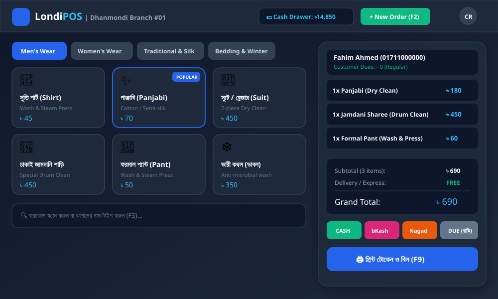
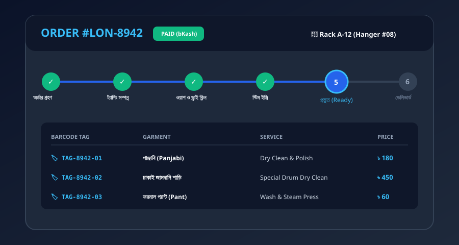
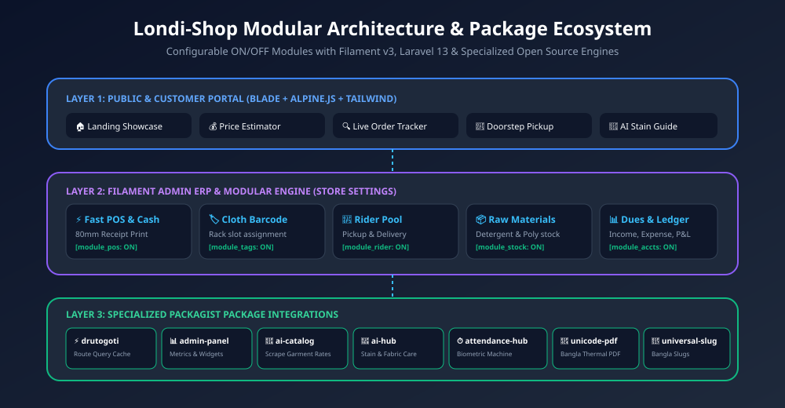

<div align="center">


# 🧺 Londi-Shop (লন্ড্রি শপ)
### Complete Bangladeshi Laundry ERP, Touchscreen POS & Customer Commerce Platform

[](https://laravel.com)
[](https://php.net)
[](https://filamentphp.com)
[](https://tailwindcss.com)
[](LICENSE)

<p align="center">
  <a href="#-core-features">Key Features</a> •
  <a href="#-public-customer-portal">Public Pages</a> •
  <a href="#-touchscreen-pos--counter">POS Terminal</a> •
  <a href="#-system-architecture">Architecture</a> •
  <a href="#-modular-switches">Modular Flags</a> •
  <a href="#-integrated-packages">Packages</a> •
  <a href="#-demo-credentials">Demo Logins</a> •
  <a href="#-quick-start">Installation</a>
</p>

---

</div>

## 🌟 Executive Summary

**Londi-Shop (লন্ড্রি শপ)** is an end-to-end cloud ERP and multi-channel customer platform built for Bangladeshi laundry chains, neighborhood dhopas (ধোপা), and dry-cleaning services. 

Unlike generic laundry software, Londi-Shop is designed specifically around Bangladeshi garments and fabric traditions:
- **Festive & Ethnic**: Panjabi (পাঞ্জাবি), Pajama (পায়জামা), Kabli (কাবলি), Sherwani (শেরওয়ানি).
- **Luxury Traditional**: Dhakai Jamdani (ঢাকাই জামদানি শাড়ি), Katan (কাতান), Benarasi (বেনারসি), Silk/Muslin (সিল্ক/মসলিন).
- **Women's Wear**: Salwar Kameez 3pc (সালোয়ার কামিজ), Burqa & Hijab (বোরকা ও হিজাব), Fancy Lehengas.
- **Western & Corporate**: 2-piece Suits & Blazers (স্যুট/ব্লেজার), Mujib Coats (মুজিব কোট), Shirts, Jeans.
- **Bedding & Winter Care**: Heavy Blankets / Kombol (লেপ/কম্বল), Bedsheets, Curtains (পর্দা).

---

## 📸 Visual Previews

### 1. Touchscreen Fast POS & Counter Terminal
Designed for high-speed counter billing in under 30 seconds with instant waterproof barcode cloth tags and 80mm thermal receipt printing.



---

### 2. Live Order Tracking Stepper
Customers track their laundry live through an animated 6-stage lifecycle using either their invoice ID (e.g., `LON-8942`) or mobile number.



---

### 3. Modular System Architecture
Configurable module engine where store owners can turn ON or OFF any operational feature based on their business model.



---

## 🎛️ Modular Feature Switches (Configurable ON / OFF)

Store managers can enable or disable modules in **Settings > Module Manager**. When disabled, routes, sidebar menus, and POS shortcuts are automatically tucked away:

| Module Key | Feature Name | Description |
|---|---|---|
| `module_pos` | **Fast Counter POS** | Touchscreen item picker, split payment, thermal receipt |
| `module_online_booking` | **Online Customer Portal** | Self-service web booking, home pickup scheduler |
| `module_home_delivery` | **Rider & Dispatch Pool** | Delivery boy assignment, route zones, live delivery tracker |
| `module_barcode_tags` | **Cloth Tagging & Rack Locator** | Waterproof barcode tags per cloth, shelf/rack slot tracking |
| `module_inventory` | **Raw Materials Stock** | Liquid detergents, starch (মাড়), polybags, hangers |
| `module_attendance` | **Biometric Attendance** | ZKTeco machine integration & iron worker piece-rate pay |
| `module_ai_assistant` | **AI Fabric & Stain Hub** | Fabric doctor, curry/oil/tea stain remover diagnostic |
| `module_sms_notification` | **Automated BD SMS Engine** | SMS sent on order received, ready on rack, and delivered |
| `module_accounts_expenses` | **Cash Drawer & Dues Ledger** | Opening cash, expenses, bKash/Nagad tally, customer credit |
| `module_multi_branch` | **Multi-Branch Outlets** | Central stock and multi-outlet shop network support |

---

## 🌐 Public Customer Pages (High Aesthetics & Mobile-Ready)

All public pages are built with modern typography, smooth micro-interactions, and Alpine.js reactivity:

1. **Homepage (`/`)**:
   - Hero banner with animated stats (50,000+ clothes cleaned, 99.8% satisfaction).
   - **Interactive Cost Estimator (খরচ ক্যালকুলেটর)**: Select garment, service type, quantity, and 24-hr express toggle for real-time BDT pricing.
   - Quick order tracking search bar.
   - 4 Pillars of fabric safety and customer testimonials from Dhaka & Chittagong.
2. **Services & Rate Card (`/services`)**:
   - Categorized rate list with search and category filtering in Alpine.js.
   - Separate pricing columns: Wash & Iron, Steam Iron Only, Dry Clean & Polish.
3. **Live Order Tracker (`/track`)**:
   - Query by Order ID (e.g., `LON-8942`) or Mobile (`01711000000`).
   - 6-Stage progress timeline stepper: Received → Tagged → In Wash → Steam Press → Ready on Rack → Delivered.
   - Itemized cloth list with barcode tags (`TAG-8942-01`), defects recorder, and 1-click printable invoice.
4. **Schedule Home Pickup (`/book-pickup`)**:
   - 3-step booking wizard (Customer info, address, garments estimate, date & slot).
   - Instant order confirmation and tracking token generator.
5. **AI Fabric Doctor & Stain Guide (`/fabric-care`)**:
   - Interactive stain troubleshooter for Turmeric/Curry, Tea/Coffee, Oil/Grease, and Ink.
   - Traditional Bangladeshi fabric care guides (Dhakai Jamdani, Katan, Tussar Silk, Mujib Coat).
6. **Branch Locator (`/branches`)**:
   - Outlets in Dhanmondi, Gulshan-2, Uttara, and Chittagong GEC with direct WhatsApp and phone links.
7. **About Us (`/about`)**:
   - Mission of modernizing traditional dhopa culture into high-tech fabric care.
8. **Contact & Corporate Laundry (`/contact`)**:
   - Bulk B2B inquiry form for hotels, hospitals, and garment factories.

---

## 📦 Specialized Packagist Packages

This platform integrates with key production packages:

| Package | Purpose & Usage | Packagist Link |
|---|---|---|
| ⚡ **Drutogoti** | Query optimization, route response caching, high concurrency | [`imrandevbd/drutogoti`](https://packagist.org/packages/imrandevbd/drutogoti) |
| 📊 **Laravel Admin Panel** | Advanced dashboard metric cards, revenue graphs | [`imrandevbd/laravel-admin-panel`](https://packagist.org/packages/imrandevbd/laravel-admin-panel) |
| 🤖 **Laravel AI Catalog** | Auto-scraping & importing laundry service rate cards | [`imrandevbd/laravel-ai-catalog`](https://packagist.org/packages/imrandevbd/laravel-ai-catalog) |
| 🧠 **Laravel AI Hub** | Fabric care diagnostics, stain treatment advice | [`imrandevbd/laravel-ai-hub`](https://packagist.org/packages/imrandevbd/laravel-ai-hub) |
| ⏱️ **Laravel Attendance Hub**| Biometric ZKTeco attendance machine integration | [`imrandevbd/laravel-attendance-hub`](https://packagist.org/packages/imrandevbd/laravel-attendance-hub) |
| 📄 **Laravel Unicode PDF** | Flawless Bangla Unicode (Nikosh/SolaimanLipi) PDF receipts | [`imrandevbd/laravel-unicode-pdf`](https://packagist.org/packages/imrandevbd/laravel-unicode-pdf) |
| 🔗 **Laravel Universal Slug**| Multi-lingual and Bangla slug generation for services | [`imrandevbd/laravel-universal-slug`](https://packagist.org/packages/imrandevbd/laravel-universal-slug) |

---

## 👥 Demo Logins & Test Accounts

The included `DatabaseSeeder` populates realistic Bangladeshi customers, demo orders, and staff roles:

| Role | Email | Password | Access Scope |
|---|---|---|---|
| **Super Admin** | `admin@londi.com` | `password` | Complete ERP, Settings, Module Manager |
| **Branch Manager** | `manager@londi.com` | `password` | Branch Orders, Stock & Expense Logs |
| **POS Cashier** | `cashier@londi.com` | `password` | Touchscreen POS & Cash Register |
| **Delivery Rider** | `rider@londi.com` | `password` | Mobile Rider Pickup/Delivery Console |
| **Customer** | `customer@londi.com` *(Phone: `01711000000`)* | `password` | Customer Order History & Tracking |

#### 🔍 Pre-seeded Demo Orders to Test in `/track`:
- **`LON-8942`**: Ready on Rack A-12 (Panjabi, Jamdani Sharee, Formal Pant - Paid via bKash ৳690).
- **`LON-9015`**: In-Wash / Dry Clean (Double Blanket, 2-piece Suit - Home Delivery with Due).
- **`LON-7621`**: Completed & Delivered to customer.

---

## 🚀 Quick Start & Installation

```bash
# 1. Clone repository
git clone https://github.com/your-username/londi-shop.git
cd londi-shop

# 2. Install dependencies
composer install
npm install && npm run build

# 3. Environment configuration
cp .env.example .env
php artisan key:generate

# 4. Migrate database and seed realistic demo data
php artisan migrate --seed

# 5. Start development server
php artisan serve
```

Visit `http://localhost:8000` to browse the customer portal, price calculator, and live tracker.

---

## 📄 License

Licensed under the [MIT License](LICENSE).  
Designed with ❤️ for Bangladeshi Fabric Care & Laundry Businesses.

---

## 🤝 Let's Connect & Collaborate

I am open to **Senior Remote Full-Stack Roles**, **AI Platform Architecture Contracts**, and **Enterprise Technical Advisory**.

- **Timezone**: UTC+6 (Dhaka / Rangpur, Bangladesh) — Flexible overlap with US, UK, and European business hours.
- **Delivery Mode**: Async-ready, Slack, Discord, Jira, GitHub, and production-first accountability.

| Channel | Address / Handle | Quick Action |
|---|---|---|
| 🌐 **Primary Portfolio** | `imrandev.bd` | [Visit Site ↗](https://imrandev.bd) |
| 📦 **Packagist Packages** | `packagist.org/packages/imrandevbd/` | [View Packages ↗](https://packagist.org/packages/imrandevbd/) |
| 💼 **LinkedIn Profile** | `linkedin.com/in/imranbru99` | [Connect ↗](https://linkedin.com/in/imranbru99) |
| 🐙 **GitHub Profile** | `github.com/imranbru99` | [Follow ↗](https://github.com/imranbru99) |
| 💬 **WhatsApp Direct** | `+880 1576-918420` | [Chat Now ↗](https://wa.me/8801576918420) |
| 📧 **Direct Email** | `me@imrandev.bd` | [Send Email ↗](mailto:me@imrandev.bd) |
| 🐦 **X (Twitter)** | `@imrandev_bd` | [Follow ↗](https://x.com/imrandev_bd) |
| 📺 **YouTube Tech** | `@ImranDevBD` | [Subscribe ↗](https://youtube.com/@ImranDevBD) |

